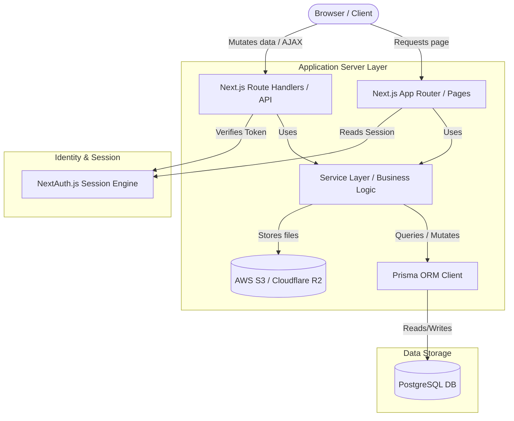

# TECHNICAL ARCHITECTURE: SKILLFORGE

This document defines the production-ready architecture of **SkillForge**, outlining layers, technology decisions, folder structure, and security measures.

---

## 1. Technology Stack Decisions

| Layer | Technology | Rationale |
| :--- | :--- | :--- |
| **Frontend Framework** | Next.js (App Router, v14+) | React Server Components (RSC) for fast loading/SEO, client-side hydration for interactivity, and built-in routing. |
| **Language** | TypeScript | Strong typing, interfaces, and compiles to reliable JS, minimizing runtime errors. |
| **Styling** | Tailwind CSS + Vanilla CSS | Utility-first styling combined with CSS variables for the core Design System tokens, ensuring modular, premium UI. |
| **Database** | PostgreSQL | Relational integrity, robust performance, support for JSONB, transactional safety for course enrollment and certificate data. |
| **ORM** | Prisma ORM | Auto-generated TypeScript client, safe migrations, visual schema tools, and built-in database-level relationships. |
| **Authentication** | NextAuth.js (Auth.js) | First-class Next.js integration, database-backed sessions, support for OAuth (GitHub, Google) and Credentials (Email/Password). |
| **State Management** | Zustand (Client-side) | Extremely lightweight, boilerplate-free state management for client-side interactions (e.g., active roadmap steps). |
| **API Layer** | Next.js Route Handlers | Next.js native API endpoints. Clean separation of concerns with Controller/Service patterns. |
| **File Storage** | AWS S3 / Cloudflare R2 | Secure, high-throughput storage for course materials, user profile pictures, and PDF certificate records. |

---

## 2. Directory Structure

The codebase is organized as a monolithic multi-tiered structure within Next.js:

```text
skillforge/
├── prisma/
│   ├── schema.prisma         # Prisma Schema definition
│   └── migrations/           # Database migration files
├── src/
│   ├── app/                  # Next.js App Router (Pages, layouts, API endpoints)
│   │   ├── (auth)/           # Authentication route group (Login, register)
│   │   ├── (dashboard)/      # Student dashboard area
│   │   ├── (landing)/        # Public-facing marketing pages (Home, about, pricing)
│   │   ├── admin/            # Secure administrative interface
│   │   ├── api/              # API Route Handlers (/api/auth, /api/courses, etc.)
│   │   ├── layout.tsx        # Global root layout
│   │   └── page.tsx          # Homepage
│   ├── components/           # Reusable UI Components
│   │   ├── ui/               # Base design system components (Button, Input, Modal, etc.)
│   │   ├── layout/           # Shared layout components (Navbar, Footer, Sidebar)
│   │   ├── dashboard/        # Dashboard specific sub-components
│   │   └── shared/           # Modular cross-feature components
│   ├── lib/                  # Utilities, libraries, third-party wrappers
│   │   ├── db.ts             # Prisma Client instance
│   │   ├── auth.ts           # NextAuth configuration and helpers
│   │   ├── utils.ts          # Helper utilities (cn tailwind-merge)
│   │   └── storage.ts        # S3 client wrapper
│   ├── services/             # Core business logic layer (Database operations)
│   │   ├── courses.ts        # Course & module data service
│   │   ├── users.ts          # User profiles & settings
│   │   ├── practice.ts       # Coding challenges & grading
│   │   └── certs.ts          # Certificate generation and signing
│   ├── styles/               # Global CSS and Tailwind configurations
│   │   └── globals.css       # Design System CSS tokens & global rules
│   └── types/                # Shared TypeScript definitions
├── public/                   # Static assets (fonts, SVGs, generated mock assets)
├── tailwind.config.ts        # Tailwind theme extensions using CSS variables
├── tsconfig.json             # TypeScript configuration
└── package.json              # App dependencies & scripts
```

---

## 3. High-Level System Architecture

SkillForge uses a hybrid architecture leveraging React Server Components for data fetching and rendering, and Next.js Route Handlers for mutations.



---

## 4. Architectural Rules & Guidelines

1. **RSC First**: Fetch data directly in Server Components using Services. Only use Client Components (`"use client"`) when there is direct user interaction (e.g., forms, interactive charts, dropdowns, code playgrounds).
2. **Service Layer Abstraction**: Do not query the database directly inside API route files or React pages. Encapsulate all database operations inside the `src/services/` layer.
3. **Strict Validation**: All API inputs must be parsed and validated using `zod` before executing business logic.
4. **Error Boundaries**: Wrap critical UI panels in error boundaries. APIs must always return predictable JSON error structures (`{ error: string, code: string }`).
5. **No Inline Styling**: Do not write random inline CSS style objects. Use Tailwind classes mapping to design tokens or custom utility classes in `globals.css`.
6. **No Mock Database Files**: Use PostgreSQL via Prisma for everything. For local development, spin up PostgreSQL via Docker or local database instances.
