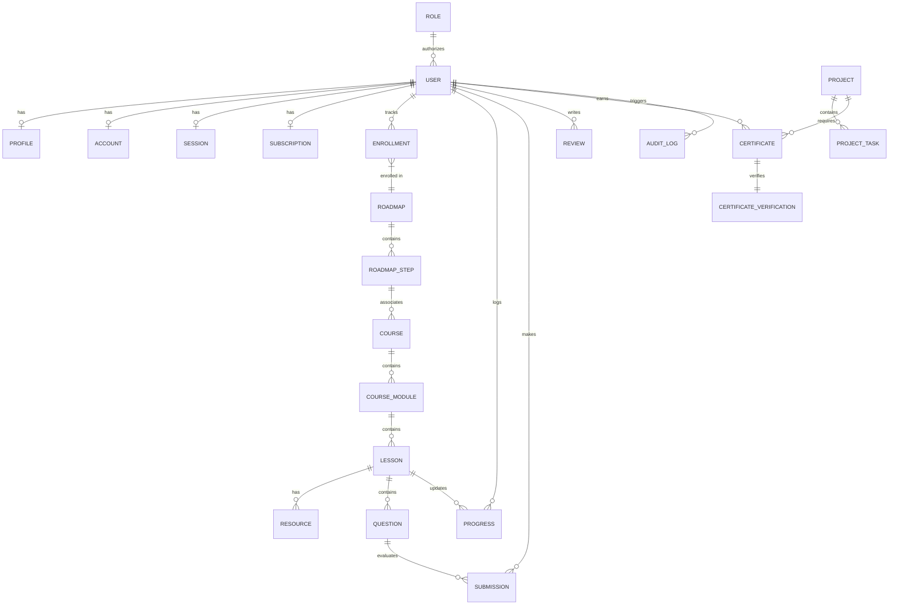

# DATABASE SCHEMA SPECIFICATION: SKILLFORGE

This document defines the relational database schema design for **SkillForge**. It contains entity definitions, data types, relationships, and indexes optimized for a PostgreSQL database managed via Prisma ORM.

---

## 1. Entity Relationship (ER) Summary

The following diagram highlights the core relationships between Users, Roadmaps, Courses, Lessons, Submissions, Projects, and Certificates:

---

## 2. Table Schemas & Fields

Below are the detailed definitions of database tables.

### 2.1. Authentication & Users

#### Table: `users`
Represents users (students, instructors, admins) on the platform.
* `id` (UUID, PK): Unique identifier.
* `name` (String, Optional): User's full name.
* `email` (String, Unique): User's email address.
* `email_verified` (DateTime, Optional): Email confirmation timestamp.
* `image` (String, Optional): Avatar image URL.
* `password_hash` (String, Optional): Cryptographically hashed password.
* `role_id` (UUID, FK): References `roles.id`.
* `created_at` (DateTime): Record creation timestamp.
* `updated_at` (DateTime): Last update timestamp.

#### Table: `roles`
System access levels.
* `id` (UUID, PK): Unique identifier.
* `name` (String, Unique): Role name (`STUDENT`, `INSTRUCTOR`, `ADMIN`, `SUPER_ADMIN`).
* `description` (String, Optional): Description of role capabilities.

#### Table: `profiles`
Detailed profile data for students.
* `id` (UUID, PK): Unique identifier.
* `user_id` (UUID, FK, Unique): References `users.id` (On Delete Cascade).
* `career_goal` (String, Optional): Selected target career (e.g., `SOFTWARE_ENGINEER`, `DATA_SCIENTIST`).
* `bio` (Text, Optional): Student biography.
* `github_url` (String, Optional): GitHub link.
* `linkedin_url` (String, Optional): LinkedIn link.
* `portfolio_url` (String, Optional): Personal site link.
* `resume_url` (String, Optional): Uploaded resume link.

---

### 2.2. Roadmaps & LMS

#### Table: `roadmaps`
Structured career roadmaps.
* `id` (UUID, PK): Unique identifier.
* `title` (String): Roadmap title (e.g., "Full-Stack Developer Roadmap").
* `description` (Text): Detailed roadmap overview.
* `slug` (String, Unique): URL-friendly string.
* `is_published` (Boolean): Access status.
* `created_at` (DateTime): Creation timestamp.

#### Table: `roadmap_steps`
Individual nodes on a career roadmap.
* `id` (UUID, PK): Unique identifier.
* `roadmap_id` (UUID, FK): References `roadmaps.id`.
* `title` (String): Step name (e.g., "Learn Version Control").
* `description` (Text): Details of the step.
* `position` (Integer): Order sequence number.
* `course_id` (UUID, FK, Optional): Optional link to a structured `courses` row.

#### Table: `courses`
Educational courses.
* `id` (UUID, PK): Unique identifier.
* `title` (String): Course title (e.g., "Git and GitHub Essentials").
* `description` (Text): Course details.
* `slug` (String, Unique): URL-friendly string.
* `thumbnail_url` (String, Optional): Cover image.
* `is_premium` (Boolean): Access filter.
* `is_published` (Boolean): Publication status.
* `instructor_id` (UUID, FK): References `users.id` (Instructor/Admin).
* `created_at` (DateTime): Creation timestamp.

#### Table: `course_modules`
Groupings of lessons inside a course.
* `id` (UUID, PK): Unique identifier.
* `course_id` (UUID, FK): References `courses.id` (On Delete Cascade).
* `title` (String): Module title.
* `position` (Integer): Ordering sequence.

#### Table: `lessons`
Individual learning content units.
* `id` (UUID, PK): Unique identifier.
* `module_id` (UUID, FK): References `course_modules.id` (On Delete Cascade).
* `title` (String): Lesson title.
* `slug` (String, Unique): URL-friendly lesson handle.
* `content` (Markdown Text): Lesson material.
* `video_url` (String, Optional): Lecture video URL.
* `position` (Integer): Lesson order inside module.
* `is_premium` (Boolean): Access gate.

#### Table: `resources`
Reference links and files.
* `id` (UUID, PK): Unique identifier.
* `lesson_id` (UUID, FK): References `lessons.id` (On Delete Cascade).
* `title` (String): Resource title.
* `url` (String): Download link or references.
* `type` (String): Resource format (`PDF`, `GITHUB_REPO`, `ARTICLE`, `ZIP`).

---

### 2.3. Enrollment & Progress

#### Table: `roadmap_enrollments`
Binds students to selected roadmaps.
* `id` (UUID, PK): Unique identifier.
* `user_id` (UUID, FK): References `users.id` (On Delete Cascade).
* `roadmap_id` (UUID, FK): References `roadmaps.id` (On Delete Cascade).
* `enrolled_at` (DateTime): Enrolled timestamp.

#### Table: `progress`
Granular tracking of user learning completion.
* `id` (UUID, PK): Unique identifier.
* `user_id` (UUID, FK): References `users.id` (On Delete Cascade).
* `lesson_id` (UUID, FK): References `lessons.id` (On Delete Cascade).
* `is_completed` (Boolean): Toggle indicator.
* `completed_at` (DateTime, Optional): Date completed.

---

### 2.4. Coding, Quizzes & Submissions

#### Table: `questions`
Practice questions, quizzes, and code challenges.
* `id` (UUID, PK): Unique identifier.
* `lesson_id` (UUID, FK, Optional): Optional link to lesson database page.
* `title` (String): Question header.
* `prompt` (Text): Problem statement/question text.
* `type` (String): Format (`MULTIPLE_CHOICE`, `CODING`).
* `difficulty` (String): Level (`EASY`, `MEDIUM`, `HARD`).
* `options` (JSON, Optional): List of answers (for MCQs).
* `correct_answer` (String, Optional): MCQ correct answer index/text.
* `starter_code` (Text, Optional): Boilerplate for coding questions.
* `test_cases` (JSON, Optional): Array of inputs/outputs for execution.

#### Table: `submissions`
Logs of code runs and quiz attempts.
* `id` (UUID, PK): Unique identifier.
* `user_id` (UUID, FK): References `users.id` (On Delete Cascade).
* `question_id` (UUID, FK): References `questions.id` (On Delete Cascade).
* `submitted_code` (Text, Optional): The code/answer provided.
* `is_correct` (Boolean): Result indicator.
* `score` (Integer): Percentage/marks scored.
* `execution_time` (Float, Optional): Code runtime.
* `created_at` (DateTime): Creation timestamp.

---

### 2.5. Projects

#### Table: `projects`
Guided portfolio-grade project designs.
* `id` (UUID, PK): Unique identifier.
* `title` (String): Project Name.
* `description` (Text): Project summary.
* `difficulty` (String): Level.
* `slug` (String, Unique): URL slug.
* `starter_repo_url` (String, Optional): Starter Git repository.
* `created_at` (DateTime): Creation timestamp.

#### Table: `project_tasks`
Tasks lists required to finish a project.
* `id` (UUID, PK): Unique identifier.
* `project_id` (UUID, FK): References `projects.id` (On Delete Cascade).
* `title` (String): Task title.
* `description` (Text): Detailed specifications of the task.
* `position` (Integer): Order sequence.

---

### 2.6. Companies & Interview Questions

#### Table: `companies`
Companies hosting tech roles.
* `id` (UUID, PK): Unique identifier.
* `name` (String, Unique): Company name.
* `logo_url` (String, Optional): Logo image link.

#### Table: `interview_questions`
Real questions sourced from placements.
* `id` (UUID, PK): Unique identifier.
* `company_id` (UUID, FK): References `companies.id` (On Delete Cascade).
* `question` (Text): The question text.
* `solution` (Text, Optional): Provided explanation.
* `role_tag` (String): Role context (e.g., Frontend).
* `difficulty` (String): Level.

---

### 2.7. Reviews & Ratings

#### Table: `reviews`
Verified course & platform reviews.
* `id` (UUID, PK): Unique identifier.
* `user_id` (UUID, FK): References `users.id` (On Delete Cascade).
* `course_id` (UUID, FK, Optional): Linked course.
* `rating` (Integer): Numerical rating (1-5).
* `comment` (Text): Feedback review.
* `is_verified_completion` (Boolean): If the reviewer actually finished the content.
* `is_approved` (Boolean): Admin moderation toggle.
* `created_at` (DateTime): Created date.

---

### 2.8. Certificates & Badges

#### Table: `certificates`
Credential records.
* `id` (UUID, PK): Unique identifier.
* `user_id` (UUID, FK): References `users.id` (On Delete Cascade).
* `course_id` (UUID, FK, Optional): Course completed.
* `project_id` (UUID, FK, Optional): Project completed.
* `issued_at` (DateTime): Date of issue.
* `certificate_hash` (String, Unique): Cryptographic secure hash signature.

#### Table: `certificate_verifications`
Public-facing verification cache.
* `id` (UUID, PK): Unique identifier.
* `certificate_id` (UUID, FK, Unique): References `certificates.id` (On Delete Cascade).
* `verification_slug` (String, Unique): Secure URL code.
* `view_count` (Integer): Verification traffic tracking.

---

### 2.9. Operations, Payments & Audit

#### Table: `subscriptions`
Binds premium packages.
* `id` (UUID, PK): Unique identifier.
* `user_id` (UUID, FK, Unique): References `users.id` (On Delete Cascade).
* `stripe_subscription_id` (String, Unique, Optional): External Stripe ID.
* `status` (String): Status (`ACTIVE`, `CANCELED`, `PAST_DUE`).
* `ends_at` (DateTime, Optional): Expiration timestamp.

#### Table: `audit_logs`
Logs operations for administrative security.
* `id` (UUID, PK): Unique identifier.
* `user_id` (UUID, FK, Optional): Acting user profile.
* `action` (String): Action description (e.g., `PUBLISH_COURSE`, `DELETE_USER`).
* `ip_address` (String, Optional): Logged origin IP.
* `metadata` (JSON, Optional): Event details payloads.
* `created_at` (DateTime): Log date.

---

## 3. Database Indexes

To keep queries fast on the primary operational tables, the following indexes are applied:

1. **`users`**: Unique index on `email` (built-in). Single column index on `role_id` for user lists.
2. **`progress`**: Compound unique index on `(user_id, lesson_id)` to speed up checking if a student completed a lesson.
3. **`submissions`**: Compound index on `(user_id, question_id)` for quick fetch of a student's question history.
4. **`lessons`**: Index on `module_id` for lessons collection fetch.
5. **`certificate_verifications`**: Unique index on `verification_slug` for instant lookup of verifiable URL hits.
6. **`audit_logs`**: Index on `created_at` for admin log pagination.
